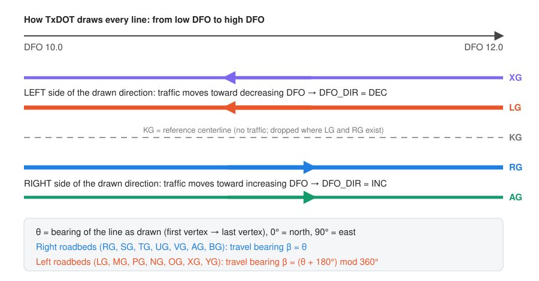
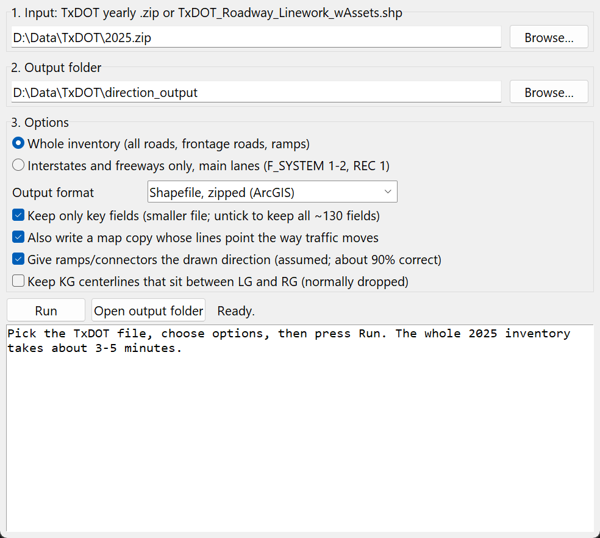
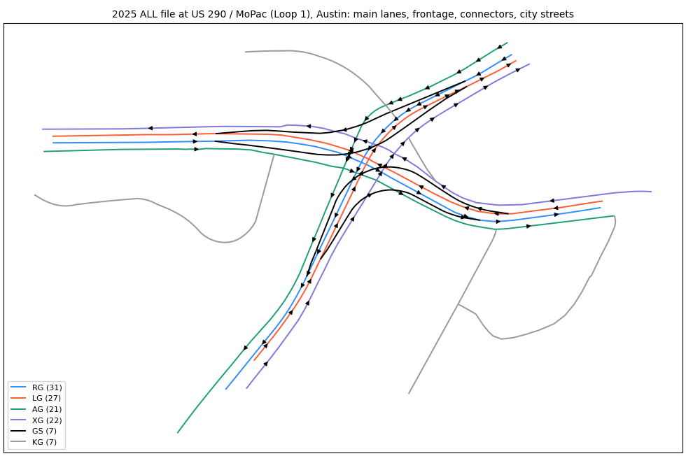
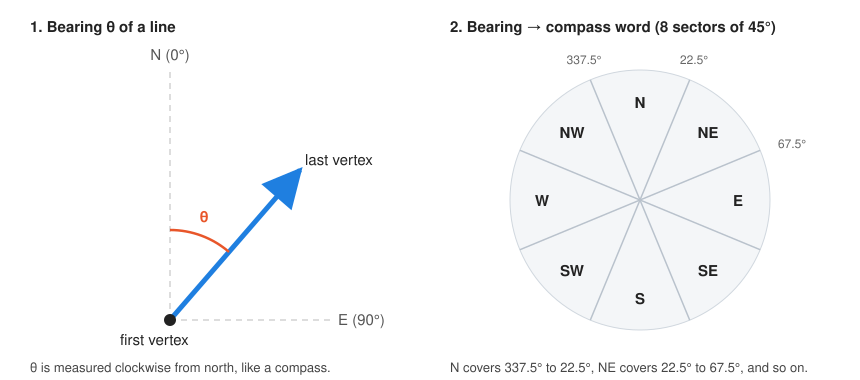
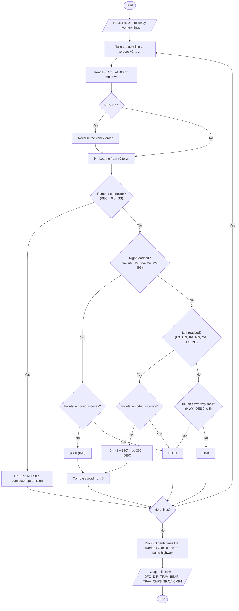

# TxDOT Roadway Inventory: travel direction for every roadbed

This tool tells you **which way traffic moves on each line of the TxDOT Roadway Inventory** (formerly RHiNO). Give it the yearly file from TxDOT and it adds a travel-direction column to every main lane, frontage road and ramp, in degrees and as a compass word (N, NE, E, ...).

The TxDOT file splits divided highways into a left roadbed (`LG`) and a right roadbed (`RG`), but it has no usable travel-direction field: `DIR_TRAV` is 0 on every Interstate and freeway line. If you want to join crashes, probe-vehicle speeds or sensor counts to the correct side of a highway, you need that direction. This tool derives it from fields TxDOT already publishes, using one rule that held on more than 99% of the lines we checked against real GPS traces.



**Contents:**
[Quick start](#quick-start-windows) ·
[Other ways to run it](#other-ways-to-run-it) ·
[What you get](#what-you-get) ·
[Show the arrows in ArcGIS or QGIS](#show-the-arrows-in-arcgis-pro-or-qgis) ·
[The method](#the-method) ·
[How well it works](#how-well-it-works) ·
[Limits](#limits) ·
[Files in this repository](#files-in-this-repository)

---

## Quick start (Windows)

1. **Get Python.** Install [Anaconda](https://www.anaconda.com/download) (free). The first time you run the tool, it checks for the packages it needs and offers to install any that are missing.
2. **Get the TxDOT data.** Download the yearly zip (about 1 GB) from the [TxDOT Roadway Inventory page](https://www.txdot.gov/data-maps/roadway-inventory.html). You do not need to unzip it.
3. **Double-click `RUN_ME.bat`.** A window opens. Pick the zip, keep the default options, and press **Run**. You can also drag the zip onto `RUN_ME.bat`.

<!-- Screenshot of the window: docs/img/window.png -->


The whole 2025 inventory (about 960,000 lines) takes about 4 to 5 minutes on a laptop. The tool unzips the one shapefile it needs (about 1.5 GB) into a folder next to the zip, such as `2025_unzipped`; you can delete that folder afterwards. The result goes to a `direction_output` folder next to the input file:

| File | Use it for |
|---|---|
| `TxDOT_Roadway_2025_ALL_direction.zip` | Analysis. The lines keep TxDOT's drawing order (low DFO to high DFO). |
| `TxDOT_Roadway_2025_ALL_direction_travel_geometry.zip` | Maps. Lines with traffic toward decreasing DFO are flipped, so an "arrow at end" symbol points the way cars drive. |

`RUN_ME.bat` looks for Anaconda, Miniforge or Miniconda first, then for any Python on your PATH that has the packages. If it finds Python without the packages, it offers to install them with `pip`.

## Other ways to run it

**Command line** (any operating system):

```bash
pip install -r requirements.txt
python txdot_direction.py --input 2025.zip --output out --key-fields --travel-geometry --assume-drawn-for-connectors
```

**Conda environment:**

```bash
conda env create -f environment.yml
conda activate txdot-direction
python txdot_direction_gui.py
```

**Only Interstates and freeways, main lanes:**

```bash
python txdot_direction.py --input 2025.zip --output out --fsystem 1 2 --rec 1
```

**From your own Python code:**

```python
import txdot_direction as td
g = td.run("2025.zip", "out", fmt="parquet", fields=td.KEY_FIELDS, assume_connectors=True)
print(g[["HWY", "RDBD_ID", "DFO_DIR", "TRAV_BEAR", "TRAV_CMP8"]].head())
```

| Option | What it does |
|---|---|
| `--input` | The TxDOT yearly `.zip`, or `TxDOT_Roadway_Linework_wAssets.shp` from inside it. |
| `--output` | Output folder. |
| `--format` | `shp` (zipped shapefile, the default), `gpkg` (GeoPackage) or `parquet` (GeoParquet). |
| `--key-fields` | Keep 13 key fields instead of all ~130. The file gets much smaller. |
| `--fields A B C` | Keep only the fields you list. |
| `--fsystem 1 2` | Keep only these functional classes (1 = Interstate, 2 = other freeway or expressway). |
| `--rec 1` | Keep only these record types (1 = main lanes). |
| `--travel-geometry` | Also write the map copy in which every one-way line points the way traffic moves. |
| `--assume-drawn-for-connectors` | Give ramps and connectors the direction they are drawn in. About 90% correct; labelled `CONNECTOR_ASSUMED`. |
| `--assume-drawn-for-unverified` | Do the same for one-way single roadbeds. Only about 61% correct, so use it with care. |
| `--keep-centerline-kg` | Keep the `KG` centerlines that sit between `LG` and `RG` (normally dropped). |

The window offers the same choices with tick boxes.

## What you get

Seven columns are added to every line.

| Column | Meaning | Example |
|---|---|---|
| `DFO_DIR` | Which way traffic moves along the DFO measure: `INC` (toward increasing DFO), `DEC` (toward decreasing DFO), `BOTH` (two-way road), `UNK` (not known) | `DEC` |
| `TRAV_BEAR` | Travel bearing in degrees, 0 = north, 90 = east. Blank for `BOTH` and `UNK`. | `220.9` |
| `TRAV_CMP8` | Travel direction as one of 8 compass words | `SW` |
| `TRAV_CMP4` | Travel direction as one of 4 compass words | `S` |
| `BEAR_DRAWN` | Bearing of the line as drawn, low DFO to high DFO | `40.9` |
| `DIR_RULE` | Which rule gave the direction (next table) | `LEFT_ROADBED` |
| `M_ORDER_OK` | 1 if TxDOT drew the line from low DFO to high DFO, 0 if the tool had to reverse it first | `1` |

| `DIR_RULE` | Lines | `DFO_DIR` | Reliability |
|---|---|---|---|
| `RIGHT_ROADBED` | RG, SG, TG, UG, VG, AG, BG | INC | 99% or better (managed lanes about 91%) |
| `LEFT_ROADBED` | LG, MG, PG, NG, OG, XG, YG | DEC | 99% or better (managed lanes about 96%) |
| `TWO_WAY` | KG on two-way roads; frontage roads coded two-way | BOTH | |
| `CONNECTOR_ASSUMED` | Ramps and connectors (REC 0 or GS), with the connector option | INC | about 90% |
| `CONNECTOR_UNVERIFIED` | Ramps and connectors, without the connector option | UNK | |
| `ONE_WAY_UNVERIFIED` | One-way single roadbeds (KG with HWY_DES 0 or 1) | UNK | |
| `OTHER` | Anything else | UNK | |

## Show the arrows in ArcGIS Pro or QGIS

Use the `_travel_geometry` file for maps.

**ArcGIS Pro**
1. Add the `_travel_geometry` zip (or the shapefile inside it).
2. Symbology → **Unique Values** → field `DFO_DIR`.
3. Give `INC` and `DEC` a line symbol with an arrow at the end (for example "Arrow Right Middle" or "Arrow at end"). Give `BOTH` a plain grey line without an arrow.

**QGIS**
1. Add the layer. Symbology → **Categorized** → column `DFO_DIR` → Classify.
2. For `INC` and `DEC`, change the symbol layer type to **Arrow** (or a marker line with an arrow marker). Leave `BOTH` as a plain grey line.

Two-way roads then show no arrow, and every one-way line shows the way cars drive.



*Example from the 2025 inventory at US 290 and MoPac in Austin. Main lanes (RG, LG), frontage roads (AG, XG) and connectors (GS) each point the way traffic moves; city streets (KG, grey) are two-way.*

---

## The method

The method rests on one fact about how TxDOT stores roads and one fact about how Texans drive.

1. **TxDOT draws every line from low DFO to high DFO.** DFO ("distance from origin") is the mile point along a route. Each vertex of a line stores its DFO as an *M value*, so the drawing direction can be checked, not assumed.
2. **Traffic in Texas keeps to the right.** TxDOT names a divided highway's roadbeds *right* (`RG`) and *left* (`LG`) as seen when you face the direction of increasing DFO. A driver on the right-hand roadbed therefore moves toward increasing DFO, and a driver on the left-hand roadbed moves the other way.

Put together: a right roadbed carries traffic in the direction the line is drawn, and a left roadbed carries traffic against it. Everything else in the tool is bookkeeping around this rule.

### Background: the TxDOT fields the tool uses

| Field | Meaning | Codes the tool uses |
|---|---|---|
| `RDBD_ID` | Roadbed | `KG` single roadbed or centerline · `RG`/`LG` right/left main lanes · `SG`/`TG` and `MG`/`PG` right/left supplemental lanes · `UG`/`VG` and `NG`/`OG` right/left managed lanes · `AG`/`BG` right frontage · `XG`/`YG` left frontage · `GS` grade-separated connector |
| `REC` | Record type | 0 connector · 1 main lanes · 2 right frontage · 3 left frontage · 5 county road · 7 city street · 8 toll · 9 federal |
| `HWY_DES` | Highway design | 0 couplet · 1 one-way · 2 two-way undivided · 3 to 5 two-way divided |
| `FRM_DFO`, `TO_DFO` | DFO at the start and end of the line | |
| `HWY` | Highway name, for example `IH0035` | |
| M value | DFO stored at each vertex of the line | |

The full field definitions are in TxDOT's *Roadway Inventory File Format* document, which comes inside the yearly zip.

### Step 1: put every line in low-to-high DFO order

For a line with vertices $v_0, v_1, \dots, v_n$ and DFO values $m_0, \dots, m_n$:

$$
\text{if } m_0 > m_n \text{ then reverse the vertex order.}
$$

In practice this step changes nothing: every line in the 2024 file (1,027,891 lines) and the 2025 file (960,621 lines) was already drawn from low DFO to high DFO. The step stays in the tool so that a future release with a different drawing order will still give correct answers. The column `M_ORDER_OK` records the outcome for each line.

### Step 2: measure the bearing of the drawn line

The bearing $\theta$ is the compass angle from the first vertex to the last vertex, measured clockwise from north (0° = north, 90° = east, 180° = south, 270° = west).



With $\varphi$ = latitude and $\lambda$ = longitude in degrees, a simple version that is accurate enough for a road segment is:

$$
\Delta x = (\lambda_n - \lambda_0)\cos\varphi_0, \qquad
\Delta y = \varphi_n - \varphi_0, \qquad
\theta = \mathrm{atan2}(\Delta x,\ \Delta y) \bmod 360^\circ
$$

The $\cos\varphi$ factor corrects for lines of longitude getting closer together away from the equator. Note that $\mathrm{atan2}$ takes the east component first, so the angle starts at north and turns clockwise. The code uses the exact version on the WGS 84 ellipsoid (`pyproj.Geod.inv`, which follows Karney 2013); for a road segment the two differ by a small fraction of a degree.

### Step 3: turn the drawn bearing into a travel bearing

The roadbed code decides whether traffic moves with the drawing or against it:

$$
\beta =
\begin{cases}
\theta & \text{right roadbed (RG, SG, TG, UG, VG, AG, BG): INC} \\
(\theta + 180^\circ) \bmod 360^\circ & \text{left roadbed (LG, MG, PG, NG, OG, XG, YG): DEC} \\
\text{none} & \text{two-way road or unknown: BOTH or UNK}
\end{cases}
$$

Some lines need a special case. These rules are applied in order, so a later rule overrides an earlier one:

1. A frontage road (`AG`, `BG`, `XG`, `YG`) coded two-way (`HWY_DES` = 2) carries both directions: `BOTH`.
2. A single roadbed (`KG`) on a two-way road (`HWY_DES` 2 to 5) carries both directions: `BOTH`.
3. A single roadbed (`KG`) on a one-way road (`HWY_DES` 0 or 1) is left `UNK`. The rule does not apply here, because a one-way street can be drawn either way relative to traffic (see [How well it works](#how-well-it-works)).
4. A connector or ramp (`REC` = 0 or `RDBD_ID` = `GS`) is left `UNK`, or given the drawn direction if you choose the connector option.

### Step 4: turn the travel bearing into a compass word

Each word covers a sector centred on its direction: 45° wide for 8 words, 90° wide for 4 words. Adding half a sector before dividing puts the sector borders in the right place:

$$
k_8 = \left\lfloor \frac{(\beta + 22.5^\circ) \bmod 360^\circ}{45^\circ} \right\rfloor,
\qquad \text{TRAV CMP8} = [\text{N, NE, E, SE, S, SW, W, NW}]_{k_8}
$$

$$
k_4 = \left\lfloor \frac{(\beta + 45^\circ) \bmod 360^\circ}{90^\circ} \right\rfloor,
\qquad \text{TRAV CMP4} = [\text{N, E, S, W}]_{k_4}
$$

So N covers 337.5° to 22.5°, NE covers 22.5° to 67.5°, and so on.

### Step 5: drop the `KG` centerline where real roadbeds exist

On a divided highway TxDOT stores three lines: `LG`, `RG`, and a `KG` reference centerline between them. No traffic drives on that centerline, so it would only confuse a map or a spatial join. A `KG` line with DFO range $[f, t]$ is dropped when an `LG` or `RG` line of the same highway (`HWY`) with range $[s, e]$ overlaps it:

$$
s < t \quad \text{and} \quad e > f .
$$

`KG` lines with no `LG` or `RG` beside them are single-roadbed roads and are kept. In 2025 this removed 40,162 centerlines.

### A worked example

Take a right-roadbed line drawn from (30.0000° N, 97.7400° W) to (30.0100° N, 97.7300° W), and a left-roadbed line beside it drawn the same way.

| | Right roadbed (RG) | Left roadbed (LG) |
|---|---|---|
| Step 1: DFO order | already low to high | already low to high |
| Step 2: $\Delta x$, $\Delta y$ | $0.01 \times \cos 30^\circ = 0.00866$, $0.01$ | same |
| Step 2: drawn bearing $\theta$ | $\mathrm{atan2}(0.00866, 0.01) = 40.9^\circ$ | $40.9^\circ$ |
| Step 3: travel bearing $\beta$ | $40.9^\circ$ (`INC`) | $(40.9 + 180) \bmod 360 = 220.9^\circ$ (`DEC`) |
| Step 4: 8-point | $\lfloor 63.4 / 45 \rfloor = 1$ → **NE** | $\lfloor 243.4 / 45 \rfloor = 5$ → **SW** |
| Step 4: 4-point | $\lfloor 85.9 / 90 \rfloor = 0$ → **N** | $\lfloor 265.9 / 90 \rfloor = 2$ → **S** |

The highway runs north-east; its right roadbed carries north-east traffic and its left roadbed carries south-west traffic. The same example is checked by `tests/test_direction.py`.

### Flowchart



### Pseudocode

```text
Algorithm 1: Travel direction of TxDOT Roadway Inventory lines
Input : lines L, each with vertices v0..vn, DFO values m0..mn, RDBD_ID, REC, HWY_DES, HWY, FRM_DFO, TO_DFO
Output: DFO_DIR, TRAV_BEAR, TRAV_CMP8, TRAV_CMP4 for each line

RIGHT    <- {RG, SG, TG, UG, VG, AG, BG}
LEFT     <- {LG, MG, PG, NG, OG, XG, YG}
FRONTAGE <- {AG, BG, XG, YG}

for each line l in L:
    if m0 > mn: reverse the vertices of l                     # step 1
    theta <- bearing(v0, vn)                                  # step 2
    if l.REC = 0 or l.RDBD_ID = GS:            dir <- UNK (or INC with the connector option)
    else if l.RDBD_ID in FRONTAGE and l.HWY_DES = 2: dir <- BOTH
    else if l.RDBD_ID in RIGHT:                dir <- INC
    else if l.RDBD_ID in LEFT:                 dir <- DEC
    else if l.RDBD_ID = KG and l.HWY_DES in {2,3,4,5}: dir <- BOTH
    else:                                      dir <- UNK
    if dir = INC: beta <- theta                               # step 3
    if dir = DEC: beta <- (theta + 180) mod 360
    if dir in {INC, DEC}:                                     # step 4
        CMP8 <- [N,NE,E,SE,S,SW,W,NW][ floor(((beta + 22.5) mod 360) / 45) ]
        CMP4 <- [N,E,S,W][ floor(((beta + 45) mod 360) / 90) ]

for each line k with RDBD_ID = KG:                            # step 5
    if some LG or RG line on the same HWY has FRM_DFO < k.TO_DFO and TO_DFO > k.FRM_DFO:
        remove k
```

---

## How well it works

We tested each part of the rule separately, on the 2024 and 2025 inventories.

**Drawing order.** All 1,027,891 lines in 2024 and all 960,621 lines in 2025 were drawn from low DFO to high DFO. Step 1 reversed none of them.

**Which side is right.** Where `LG` and `RG` run side by side, `RG` lay to the right of the increasing-DFO direction in all of more than 24,000 places we tested.

**Against real traffic.** We compared the tool's travel bearing with the direction of commercial-vehicle GPS traces (Geotab Altitude one-way road segments, 2024). Those data are licensed and are not part of this repository; only the summary numbers are reported here.

- On Interstate and freeway main lanes, using the Texas A&M Transportation Institute's link between Geotab segments and TxDOT roadbeds, the directions agreed on **68,925 of 68,927 segments (99.997%)**. Every segment of the loop highways agreed: IH 610 and Beltway 8 (Loop 8) in Houston, IH 410 in San Antonio, IH 635 in Dallas, IH 820 in Fort Worth, and Loop 1 in Austin. Loops are a hard test, because the drawn direction of a loop turns through all 360°.
- Across the whole state, matching each Geotab segment to the nearest TxDOT line within 10 m and running in the same general direction (within 20°):

| Roadbed | Geotab agrees with the tool | Segments matched |
|---|---|---|
| `AG` right frontage | 99.9% | 31,797 |
| `XG` left frontage | 99.8% | 31,509 |
| `RG` / `LG` main lanes | 99.2% / 99.2% | 17,634 / 17,390 |
| `SG` / `MG` supplemental lanes | 100% / 99.5% | 244 / 219 |
| `NG` / `UG` managed lanes | 95.7% / 90.6% | 469 / 544 |
| `BG` / `YG` second frontage | 100% / 87.7% | 246 / 219 |
| Connectors (`GS`), drawn direction | 89.9% | 4,363 |
| One-way `KG`, drawn direction | 61.2% | 402 |

The last two rows explain the defaults. Connectors follow their drawing direction 9 times out of 10, so the tool offers that as a labelled assumption. One-way single roadbeds follow it only 6 times out of 10, barely better than a coin toss, so the tool leaves them as `UNK`.

**2025 result** (whole inventory, connector option on):

| `DIR_RULE` | Lines |
|---|---|
| `TWO_WAY` | 811,055 |
| `RIGHT_ROADBED` | 51,747 |
| `LEFT_ROADBED` | 50,945 |
| `CONNECTOR_ASSUMED` | 5,357 |
| `ONE_WAY_UNVERIFIED` | 1,355 |
| **Total kept** | **920,459** |
| `KG` centerlines dropped | 40,162 |

## Limits

- **Ramps are about 90% right.** Use `DIR_RULE = CONNECTOR_ASSUMED` to filter them out when you need certainty.
- **One-way single roadbeds** (downtown one-way pairs, for example) are left `UNK`. The TxDOT file does not say which way they run.
- **Managed lanes** (`NG`, `UG`) include reversible lanes whose direction changes by time of day; agreement there is 91% to 96%.
- **Frontage roads coded two-way** may since have been converted to one-way. In 2024, 616 `AG` and 760 `XG` lines coded two-way matched one-way Geotab traces.
- **The bearing is end to end.** `TRAV_BEAR` is the direction from the first to the last vertex. On a long curved line (a loop ramp, say) the heading at any one point can differ a lot from that. For the local direction at a point, use the vertex order of the `_travel_geometry` file.
- **The `KG` drop works by DFO range.** A `KG` line that overlaps `LG` or `RG` for only part of its length is dropped whole. Use `--keep-centerline-kg` if this matters for your study.
- **Texas only.** The rule depends on TxDOT's roadbed codes and on right-hand traffic. Other states store direction differently.

## Files in this repository

```
RUN_ME.bat               double-click to open the window (Windows)
txdot_direction_gui.py   the window
txdot_direction.py       the method; also a command-line tool and an importable module
tests/test_direction.py  a small synthetic test (python -m pytest tests)
requirements.txt         packages for pip
environment.yml          the same for conda
docs/img/                figures used in this README
```

No TxDOT, crash or GPS data are stored in this repository. Download the TxDOT inventory yourself from TxDOT.

## Requirements

Python 3.10 or newer with `geopandas`, `pyogrio`, `pyshp`, `pyproj`, `shapely`, `numpy` and, for GeoParquet output, `pyarrow`. For the whole state, allow a few GB of free memory and about 3 GB of disk space for the unzipped input and the outputs.

## References

- TxDOT. *Roadway Inventory* (yearly data and the *Roadway Inventory File Format* document). https://www.txdot.gov/data-maps/roadway-inventory.html
- Karney, C. F. F. (2013). Algorithms for geodesics. *Journal of Geodesy*, 87, 43–55. https://doi.org/10.1007/s00190-012-0578-z

## License

MIT. See [LICENSE](LICENSE).

## How to cite

If you use this tool, please cite it as:

Rafe, A. (2026). *TxDOT Roadway Inventory travel direction* (Version 1.0.0) [Computer software]. Texas State University. https://github.com/pozapas/txdot-roadway-direction

```bibtex
@software{rafe2026txdotdirection,
  author  = {Rafe, Amir},
  title   = {TxDOT Roadway Inventory travel direction},
  version = {1.0.0},
  year    = {2026},
  url     = {https://github.com/pozapas/txdot-roadway-direction}
}
```

## Author

Amir Rafe, Texas State University
